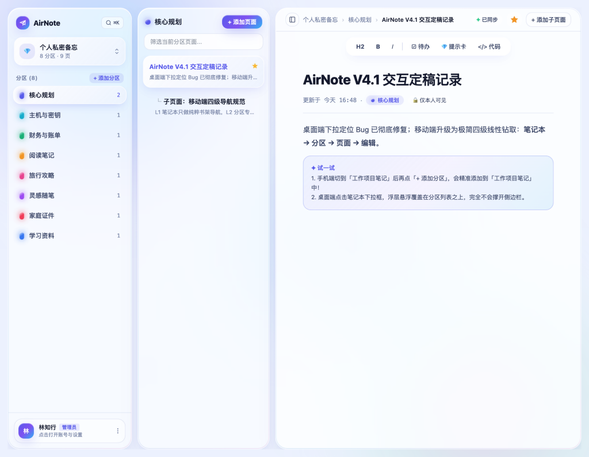
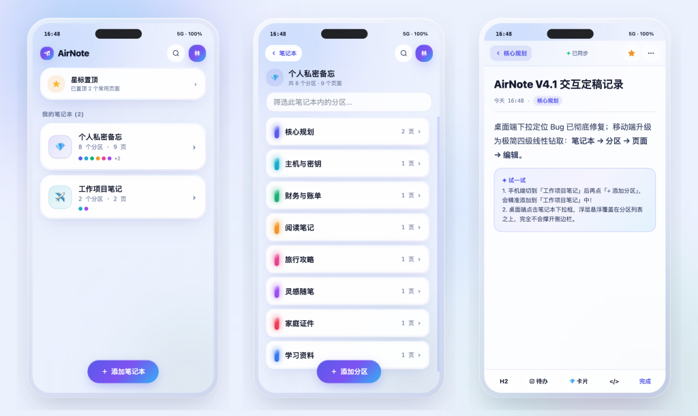

# AirNote

> 轻盈、私密、现代的个人与受邀小团队网页版网络记事本（类 OneNote 三级结构 + 液态琉璃双主题 + 自选 2FA + 严格用户数据隔离）。





完整设计规格与交互原型位于 [docs/README.md](./docs/README.md)。

---

## 核心特性

- **三级结构化笔记（OneNote 心智）**：笔记本 → 彩晶分区 → 页面/子页面，支持星标置顶、跨分区移动、拖拽/按键排序、软删除回收站（恢复/彻底删除/清空）。
- **TipTap 富文本与隔离附件**：H1–H3、加粗/斜体/下划线/删除线/高亮、待办清单、琉璃提示卡（Callout）、语法高亮代码块、表格、分割线、`/` 斜杠命令菜单、截图粘贴/上传、每用户物理隔离附件目录（`data/uploads/<user_id>/`）与防 XSS 下载响应头。
- **SQLite WAL + FTS5 毫秒级全文检索**：桌面端 `⌘K` / 移动端右上角搜索按钮直达，支持中英文混合检索与高亮片段，严格按 `user_id` 隔离。
- **封闭邀请制与自选 2FA**：禁止自助注册；Argon2id 密码哈希；用户登录后可自主开启/关闭标准 RFC 6238 TOTP（兼容 Google / Microsoft Authenticator，含 QR 码、移动端优先 Base32 复制与 `otpauth://` 直连、±30s 容错、防重放、8 组一次性备用恢复码）；IP + 账号双维度防爆破限流。
- **管理员控制台（严格隐私边界）**：仅 `admin` 可见，支持成员创建（自动生成高强度一次性初始密码）、启用/停用（停用即时吊销全部活跃 Session）、重置密码、解绑 2FA 与安全审计日志分页；**不提供任何读取或统计他人笔记的入口**。
- **全端自适应 UI**：「冰晶晨露 / 星钻夜幕」双主题 + 「璀璨 / 柔和」两档光效；桌面端悬浮三栏 + 专注模式；移动端纯净四级钻取（L1 笔记本 → L2 分区 → L3 页面 → L4 沉浸编辑）。

---

## 快速开始

### 环境要求

- Node.js `>= 22.13`（推荐本项目验证环境 **Node.js `v26.13.0`**，原生内置 `node:sqlite`）

### 1. 安装依赖与配置环境变量

```bash
npm install
cp .env.example .env
```

生成生产环境 32 字节加密主密钥（用于 AES-256-GCM 加密用户 TOTP Secret）：

```bash
node -e "console.log(require('crypto').randomBytes(32).toString('hex'))"
```

将输出的 64 位十六进制字符串填入 `.env` 的 `MASTER_KEY=`（开发态若留空将自动在 `data/.master.key` 生成持久化密钥；生产态 `NODE_ENV=production` 强制要求设置 `MASTER_KEY` 或已有 `data/.master.key`）。

### 2. 初始化首位超级管理员

```bash
npm run init-admin
```

也支持非交互参数方式：

```bash
npm run init-admin -- --username admin@airnote.local --display-name 管理员 --password 'YourStrongPassword!1'
```

### 3. 开发模式运行

```bash
npm run dev
```

- 前端 Vite 开发服务器：`http://localhost:5173`（自动代理 `/api` 至 `http://127.0.0.1:3100`）
- 后端 Hono API 服务：`http://127.0.0.1:3100`

### 4. 生产单进程部署

```bash
npm run build && npm start
```

生产态单进程同时托管后端 `/api/*` 与前端构建产物 `dist/client`，默认监听 `http://127.0.0.1:3100`（可通过 `.env` 的 `HOST` / `PORT` 调整）。

#### 反向代理 HTTPS 示例（Nginx）

若通过公网或内网 HTTPS 反向代理访问，请在 `.env` 中设置 `TRUST_PROXY=true` 与 `COOKIE_SECURE=auto`（或 `true`）：

```nginx
server {
    listen 443 ssl http2;
    server_name note.example.com;

    client_max_body_size 25M;

    location / {
        proxy_pass http://127.0.0.1:3100;
        proxy_set_header Host $host;
        proxy_set_header X-Real-IP $remote_addr;
        proxy_set_header X-Forwarded-For $proxy_add_x_forwarded_for;
        proxy_set_header X-Forwarded-Proto $scheme;
    }
}
```

---

## 数据备份与恢复

### 方式一：内置在线热备份命令（推荐，无需停服）

基于 Node.js `node:sqlite` 原生在线备份 API，WAL 模式下可零停机安全生成一致性快照：

```bash
npm run backup
# 或指定输出目录：
npm run backup -- /path/to/backup-dir
```

### 方式二：使用 `sqlite3` CLI 在线热备份

```bash
sqlite3 data/airnote.db ".backup 'data/backups/airnote-$(date +%Y%m%d-%H%M%S).db'"
```

> **完整容灾提示**：迁移或异地灾备时，请一并备份：
> 1. 数据库快照 `airnote-*.db`
> 2. 隔离附件目录 `data/uploads/`
> 3. `.env` 中的 `MASTER_KEY`（用于解密已开启 2FA 用户的 TOTP 密钥）

---

## 测试与质量校验

```bash
npm run typecheck   # TypeScript 全仓严格类型检查
npm test            # 运行全部认证、2FA、隔离、FTS5 与附件自动化测试
npm run build       # 验证生产态前后端打包构建
```
