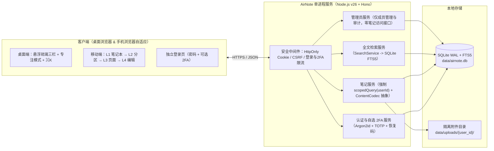

# 02 · AirNote 系统架构、数据模型与安全设计

## 1. 技术栈决策（已定稿）

综合**运行效率**、**长期维护成本**与目标开发主机已安装的 **Node.js `v26.13.0`**，选定 **TypeScript 全栈轻量单进程架构**：

| 层级 | 选型 | 选型依据 |
| :--- | :--- | :--- |
| **前端框架** | React 19 + TypeScript + Vite | 构建极快、状态驱动流畅，适合三栏工作台与移动端四级动画 |
| **样式体系** | Tailwind CSS v4 | 原子化高效实现液态琉璃玻璃态、浅/深双主题与原生响应式断点 |
| **富文本编辑器** | TipTap（ProseMirror 内核） | 现代模块化富文本，原生支持占位符（Placeholder 扩展）、待办、代码块、表格、提示卡与 Markdown 快捷键 |
| **后端服务** | Node.js v26 + Hono | 极简零负担、内存占用仅 ~50–80MB、API 延迟 1–3ms，生产态单进程同时托管前端静态资源与后端 API |
| **本地数据库** | SQLite 3（开启 WAL 模式 + FTS5） | 单文件 `data/airnote.db`，零外部数据库进程，支持高并发读写与毫秒级全文检索；Node 26 原生支持 `node:sqlite`（或 Drizzle + SQLite 驱动），维护零编译痛点 |
| **认证与密码学** | Argon2id（密码哈希）+ `otpauth`（TOTP）+ `qrcode` + Node `crypto`（AES-256-GCM） | 行业标准安全实践 |

### 技术栈横向评估记录
- **TS 全栈（最终选定）**：前后端同语言、类型共享、维护成本最低、运行效率完全充裕。
- **Go + React**：运行内存更低（~20MB），但双语言维护成本明显更高，对于个人/小团队私有应用边际收益不划算。
- **Python FastAPI + React**：双语言 + 虚拟环境依赖，无明显效率或维护优势。

---

## 2. 总体系统架构



---

## 3. 安全架构与架构决策记录（ADR）

### ADR-01：正文落盘加密取舍（已定稿：不使用正文落盘加密）

经过对安全威胁边界与日常维护成本的权衡，正式决定：
1. **认证敏感凭证（必须加密/哈希）**：
   - 用户密码：**Argon2id** 单向加盐哈希。
   - 用户 TOTP Secret：**AES-256-GCM** 服务端主密钥加密存储（`totp_secret_enc`）。
   - Session Token 与 8 组恢复码：数据库仅存 **SHA-256 / Argon2id 哈希**，不存明文。
2. **笔记正文（首版不加密落盘）**：
   - **理由**：
     - 完整发挥 **SQLite FTS5** 原生毫秒级全文搜索优势；
     - 零密钥丢失导致全库永久变砖的风险，备份恢复极其简单；
     - 明确认知威胁边界：无论是系统全盘加密（开机运行态已解密）还是服务端 `.env` 密钥加密，都只能防「备份/硬盘离线泄露」，**无法防服务器 root 被攻破或拥有服务器最高权限的管理员**；只有浏览器端「端到端零知识加密（E2EE）」才能防服务器与管理员，但会带来「忘密码永久丢数据 + 前端检索受限」的显著代价。因此当前版本选择轻量实用路线。
   - **平滑演进预留（零成本扩展点）**：
     - `pages` 表预留 `encryption_ver INTEGER NOT NULL DEFAULT 0`（`0` = 明文，`1` = AES-256-GCM 密文）；
     - 笔记正文读写统一经过 `ContentCodec.encode/decode` 抽象层；
     - 检索统一经过 `SearchService` 接口抽象；未来若需启用正文加密，仅需替换这 2 处实现并跑数据迁移脚本即可平滑升级。

### 3.2 严格多用户数据隔离防线（防越权 IDOR）
- 所有业务表（`notebooks`、`sections`、`pages`、`attachments`、`pages_fts`）均强绑定 `user_id`。
- 数据访问层封装强制隔离上下文，**每一条单对象读写删查 SQL 都必须带 `AND user_id = ?`**，杜绝通过猜测/枚举 ID 访问他人数据。
- 附件按 `data/uploads/<user_id>/<uuid>` 物理分目录存储，禁止直接作为公开静态目录暴露，必须经鉴权接口校验 `attachment.user_id === session.userId` 后流式返回。

### 3.3 登录、可选 2FA 与防爆破机制
- **登录双路径**：
  - 未开启 2FA：`POST /api/auth/login` 验密通过 → 直接写 `sessions` 表并签发 `HttpOnly, SameSite=Lax, Secure(HTTPS)` Cookie。
  - 已开启 2FA：`POST /api/auth/login` 验密通过 → 返回 5 分钟短期 `challengeToken` → 前端提交 6 位 TOTP（或备用恢复码）至 `POST /api/auth/verify-2fa` → 校验通过后签发正式 Session Cookie。
- **TOTP 防重放与时钟容错**：允许 `±1` 个时间步（±30 秒）容错；记录 `totp_last_step`，同一时间步验证码验证成功后立即失效不可重用。
- **防爆破限流**：登录与 2FA 校验接口均实施「IP + 账号」双维度限流（连续错误 5 次锁定 15 分钟），并写入 `audit_logs`。
- **即时吊销**：管理员停用账号或用户修改密码时，立即删除该用户在 `sessions` 表中的全部会话记录。

---

## 4. SQLite 数据库表结构（DDL 蓝图）

初始化开启：`PRAGMA journal_mode = WAL; PRAGMA foreign_keys = ON; PRAGMA busy_timeout = 5000;`

```sql
-- 1. 用户表
CREATE TABLE users (
  id TEXT PRIMARY KEY,
  username TEXT NOT NULL UNIQUE,
  display_name TEXT NOT NULL,
  password_hash TEXT NOT NULL,
  role TEXT NOT NULL CHECK (role IN ('admin', 'user')) DEFAULT 'user',
  status TEXT NOT NULL CHECK (status IN ('active', 'disabled')) DEFAULT 'active',
  totp_secret_enc TEXT,
  totp_enabled INTEGER NOT NULL DEFAULT 0,
  totp_last_step INTEGER,
  must_change_password INTEGER NOT NULL DEFAULT 1,
  created_at INTEGER NOT NULL,
  last_login_at INTEGER
);

-- 2. 会话表（支持即时踢出）
CREATE TABLE sessions (
  id TEXT PRIMARY KEY,
  user_id TEXT NOT NULL REFERENCES users(id) ON DELETE CASCADE,
  token_hash TEXT NOT NULL UNIQUE,
  user_agent TEXT,
  ip_address TEXT,
  expires_at INTEGER NOT NULL,
  created_at INTEGER NOT NULL
);

-- 3. 2FA 一次性备用恢复码
CREATE TABLE recovery_codes (
  id TEXT PRIMARY KEY,
  user_id TEXT NOT NULL REFERENCES users(id) ON DELETE CASCADE,
  code_hash TEXT NOT NULL,
  used_at INTEGER
);

-- 3b. 短期认证挑战令牌（登录 2FA 挑战与 2FA 绑定临时会话）
CREATE TABLE auth_challenges (
  id TEXT PRIMARY KEY,
  user_id TEXT NOT NULL REFERENCES users(id) ON DELETE CASCADE,
  kind TEXT NOT NULL CHECK (kind IN ('login_2fa', 'totp_setup')),
  token_hash TEXT NOT NULL UNIQUE,
  payload_enc TEXT,
  expires_at INTEGER NOT NULL,
  consumed_at INTEGER,
  created_at INTEGER NOT NULL
);

-- 4. 笔记本表
CREATE TABLE notebooks (
  id TEXT PRIMARY KEY,
  user_id TEXT NOT NULL REFERENCES users(id) ON DELETE CASCADE,
  name TEXT NOT NULL,
  icon TEXT NOT NULL DEFAULT '📓',
  color TEXT NOT NULL DEFAULT '#6366F1',
  sort_order INTEGER NOT NULL DEFAULT 0,
  created_at INTEGER NOT NULL,
  updated_at INTEGER NOT NULL
);

-- 5. 分区表
CREATE TABLE sections (
  id TEXT PRIMARY KEY,
  user_id TEXT NOT NULL REFERENCES users(id) ON DELETE CASCADE,
  notebook_id TEXT NOT NULL REFERENCES notebooks(id) ON DELETE CASCADE,
  name TEXT NOT NULL,
  color TEXT NOT NULL DEFAULT '#6366F1',
  sort_order INTEGER NOT NULL DEFAULT 0,
  created_at INTEGER NOT NULL,
  updated_at INTEGER NOT NULL
);

-- 6. 页面表（支持子页面与加密扩展版本位）
CREATE TABLE pages (
  id TEXT PRIMARY KEY,
  user_id TEXT NOT NULL REFERENCES users(id) ON DELETE CASCADE,
  section_id TEXT NOT NULL REFERENCES sections(id) ON DELETE CASCADE,
  parent_page_id TEXT REFERENCES pages(id) ON DELETE SET NULL,
  title TEXT NOT NULL DEFAULT '',
  content_json TEXT NOT NULL DEFAULT '{"type":"doc","content":[]}',
  content_text TEXT NOT NULL DEFAULT '',
  encryption_ver INTEGER NOT NULL DEFAULT 0,
  is_pinned INTEGER NOT NULL DEFAULT 0,
  is_deleted INTEGER NOT NULL DEFAULT 0,
  sort_order INTEGER NOT NULL DEFAULT 0,
  created_at INTEGER NOT NULL,
  updated_at INTEGER NOT NULL
);

-- 7. 附件表
CREATE TABLE attachments (
  id TEXT PRIMARY KEY,
  user_id TEXT NOT NULL REFERENCES users(id) ON DELETE CASCADE,
  page_id TEXT NOT NULL REFERENCES pages(id) ON DELETE CASCADE,
  filename TEXT NOT NULL,
  mime_type TEXT NOT NULL,
  size_bytes INTEGER NOT NULL,
  storage_path TEXT NOT NULL,
  created_at INTEGER NOT NULL
);

-- 8. 安全审计日志
CREATE TABLE audit_logs (
  id TEXT PRIMARY KEY,
  actor_id TEXT REFERENCES users(id) ON DELETE SET NULL,
  action TEXT NOT NULL,
  target_info TEXT,
  ip_address TEXT,
  created_at INTEGER NOT NULL
);

-- 9. 全文检索虚拟表（FTS5）
CREATE VIRTUAL TABLE pages_fts USING fts5(
  page_id UNINDEXED,
  user_id UNINDEXED,
  title,
  content_text,
  tokenize = 'unicode61'
);

-- 核心索引
CREATE INDEX idx_notebooks_user ON notebooks(user_id, sort_order);
CREATE INDEX idx_sections_user_nb ON sections(user_id, notebook_id, sort_order);
CREATE INDEX idx_pages_user_sec ON pages(user_id, section_id, is_deleted, sort_order);
CREATE INDEX idx_sessions_user ON sessions(user_id);
CREATE INDEX idx_recovery_codes_user ON recovery_codes(user_id);
CREATE INDEX idx_auth_challenges_user ON auth_challenges(user_id, kind);
CREATE INDEX idx_audit_logs_created ON audit_logs(created_at DESC);
```

---

## 5. REST API 接口契约

### 系统健康检查
- `GET /api/health` — 服务存活探测（无需登录）

### 认证与个人安全（`/api/auth/*`）
- `POST /api/auth/login` — 账号密码校验（返回 `authenticated` 或 `requires_2fa` + `challengeToken`）
- `POST /api/auth/verify-2fa` — 校验 6 位 TOTP 或 8 位恢复码，签发正式 Session Cookie
- `POST /api/auth/logout` — 销毁当前 Session 并清除 Cookie
- `GET /api/auth/me` — 获取当前登录用户信息（含 `role`、`totpEnabled`、`mustChangePassword`）
- `POST /api/auth/change-password` — 修改密码（吊销其他设备旧 Session）
- `POST /api/auth/2fa/setup` — 生成临时 TOTP Secret、QR DataURL 与 `otpauth://` URI
- `POST /api/auth/2fa/confirm` — 校验 6 位动态码，正式启用 2FA 并一次性返回 8 组恢复码
- `POST /api/auth/2fa/disable` — 验证当前密码后关闭 2FA 并清除密钥与恢复码

### 笔记本 / 分区 / 页面 / 搜索（全部强校验登录态与 `user_id`）
- `GET/POST /api/notebooks`、`POST /api/notebooks/reorder`、`PATCH/DELETE /api/notebooks/:id`
- `GET /api/sections`、`GET/POST /api/notebooks/:nbId/sections`、`POST /api/notebooks/:nbId/sections/reorder`、`PATCH/DELETE /api/sections/:id`
- `GET/POST /api/sections/:secId/pages`、`POST /api/sections/:secId/pages/reorder`、`GET/PATCH/DELETE /api/pages/:id`（`PATCH` 支持更新标题/正文、星标置顶、移动 `sectionId`、挂载 `parentPageId`、恢复回收站；`DELETE` 支持 `?permanent=true` 彻底删除）
- `GET /api/pages/pinned` — 获取当前用户的星标置顶页面
- `GET /api/pages/trash`、`DELETE /api/pages/trash/empty` — 获取或清空当前用户的回收站页面
- `GET /api/pages/quick-search?q=...` — 轻量页面快速筛选
- `GET /api/search?q=...` — 当前用户隔离范围内的 FTS5 全文搜索
- `GET/POST /api/pages/:pageId/attachments`、`GET/DELETE /api/attachments/:id`

### 管理员控制台（`/api/admin/*`，强校验 `role === 'admin'`）
- `GET /api/admin/users` — 成员列表（含 2FA 状态、启用状态、最近登录时间，**不含任何笔记统计或内容**）
- `POST /api/admin/users` — 创建新受邀用户并返回一次性初始密码
- `PATCH /api/admin/users/:id/status` — 启用/停用成员（停用即刻踢下线）
- `POST /api/admin/users/:id/reset-password` — 重置临时密码并强制下次登录修改
- `POST /api/admin/users/:id/reset-2fa` — 为丢手机成员解绑 2FA
- `GET /api/admin/audit-logs` — 分页查看安全审计日志
